<div align="center">

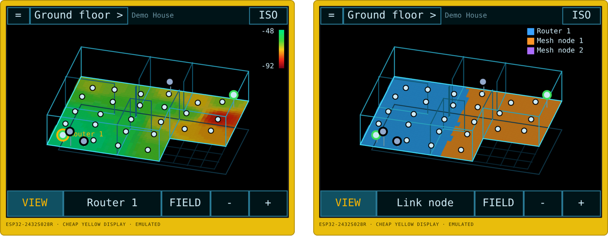

# CYD WI-FI MAPPER

### Walk your house with a $15 screen and see where the Wi-Fi really goes.

[](https://github.com/waywardtech/CYD-wifi-mapper/actions/workflows/ci.yml)


[](LICENSE)

**[The idea](#-the-idea)** · **[A survey, step by step](#-a-survey-step-by-step)** · **[Floor plans](#-floor-plans-traced-for-you)** · **[Try it in a browser](#-try-it-in-a-browser)** · **[Build and flash](#-build-and-flash)** · **[How it works](#-how-it-works)**

</div>

<sub>Every picture on this page is drawn by the project's own code: device screens by the desktop simulator, the two above by the WebAssembly build of the firmware's UI. They are not photos of a device. The house is a made-up demo, and its signal comes from a simulated radio (see <a href="#-try-it-in-a-browser">Try it in a browser</a>).</sub>

---

**CYD WI-FI MAPPER** turns an ESP32 **"Cheap Yellow Display"** into a handheld Wi-Fi survey tool. You trace your floor plans once, place your router and mesh nodes on a wireframe model of the house, then walk from room to room tapping where you stand. At each spot the CYD listens to every access point it can hear, notes which mesh node it would join, and saves it all to the microSD card. Back on the screen, the readings become a **heat map painted onto the model**, floor by floor, in 2D or isometric 3D.

> **Status: v0.1, not yet run on a real CYD.** The firmware compiles for both CYD variants in CI, the core logic is unit-tested on the host, every screen is exercised in the simulator, and the setup page is tested end to end in Chrome. The hardware glue (touch reads, calibration, SD and display together, scan timing, memory headroom) has not met a device yet. See [First run on hardware](#-first-run-on-hardware).

## 📡 The idea

A phone app tells you how strong the Wi-Fi is *where you are standing*. It doesn't tell you what the signal looks like across the house, which node your devices end up on, or whether that basement corner is weak because of distance, a wall, or the floor above it.

Survey tools that answer those questions exist, but they're laptop software built for offices. This is the home version: a $15 board, your own floor plans, and a walk around the house. The CYD does the listening and the drawing. A phone or laptop is only needed once, to trace the plans.

## ✨ What it does

| | |
|---|---|
| 🏠 **Floor plans in, model out** | Load an estate agent or survey plan image. Walls are found and traced automatically, then stacked by level: Basement, Ground, First and so on, worked out from the floor's name. |
| 🧊 **Wireframe model** | Isometric by default, 2D plan with one tap. Drag to rotate in 3D or pan in 2D. Other floors show as faint outlines above and below. |
| 📍 **Place your kit** | Router, mesh nodes, switches, speakers, TVs, consoles. Tap the spot in 2D, then set the height in 3D by dragging a pole. |
| 🔗 **Bind radios** | Stand next to a router or mesh node and pick it from a list of what the CYD can hear. The strongest entry is almost always the device in front of you. |
| 📶 **Survey** | Tap where you're standing, optionally set how high you're holding it, then *SCAN HERE*. Three scans are averaged and up to 24 access points are saved per spot, so binding a node later still counts readings already taken. |
| 🎨 **Heat maps** | Red through yellow to green, clipped to the inside of the floor's outline. Readings far from any measurement are drawn darker, because they're guesses. |
| 🧩 **The mesh split** | *Link node* colours the floor by which mesh node the CYD joined at each spot. It works with any mesh: it records the access point it associated with, so no vendor API is needed. |
| 🗂️ **Scan sets** | Each survey is its own project. Map the whole house once, and keep a separate "office router test" for trying a node in three different places. |
| 💾 **Plain files on the card** | JSON for the plans, one line per measurement for the readings. Export to CSV from the setup page. Format in [`docs/DATA_FORMAT.md`](docs/DATA_FORMAT.md). |

## 🧭 A survey, step by step

<table>
<tr>
<td width="33%">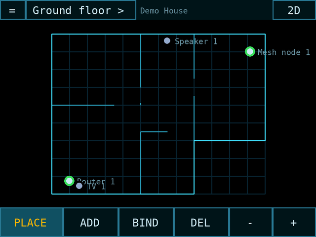</td>
<td width="33%">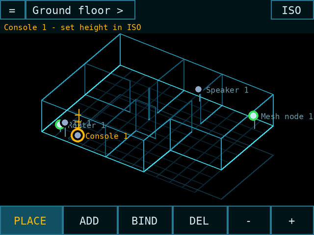</td>
<td width="33%">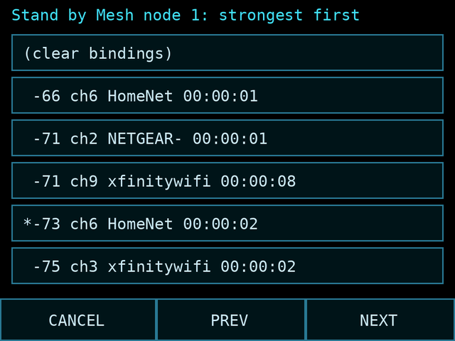</td>
</tr>
<tr>
<td><sub><b>1. Place.</b> Switch to 2D, tap <i>ADD</i>, tap the spot, choose what it is.</sub></td>
<td><sub><b>2. Set the height.</b> In ISO, drag the amber pole. Walls are assumed a standard height per floor.</sub></td>
<td><sub><b>3. Bind.</b> Standing by a node, pick its radio. Strongest first.</sub></td>
</tr>
<tr>
<td>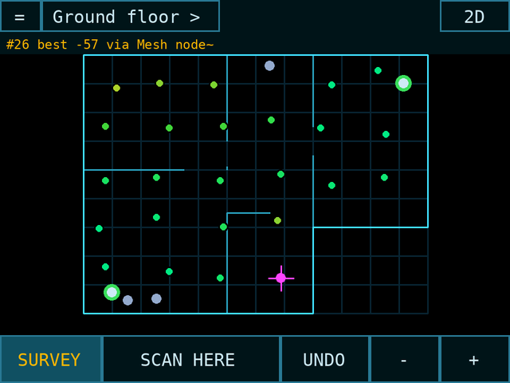</td>
<td>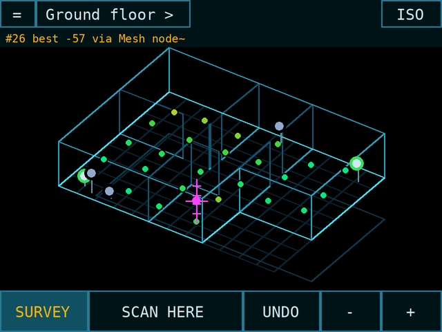</td>
<td>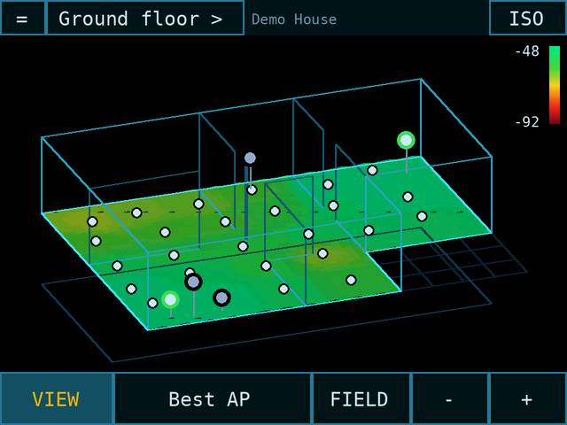</td>
</tr>
<tr>
<td><sub><b>4. Survey.</b> Tap where you stand, then <i>SCAN HERE</i> and hold still for a few seconds.</sub></td>
<td><sub><b>5. Keep walking.</b> Each spot is saved to the card the moment it's taken. <i>UNDO</i> takes the last one back.</sub></td>
<td><sub><b>6. View.</b> The readings become a field across the floor.</sub></td>
</tr>
</table>

### Reading the results

<table>
<tr>
<td width="50%">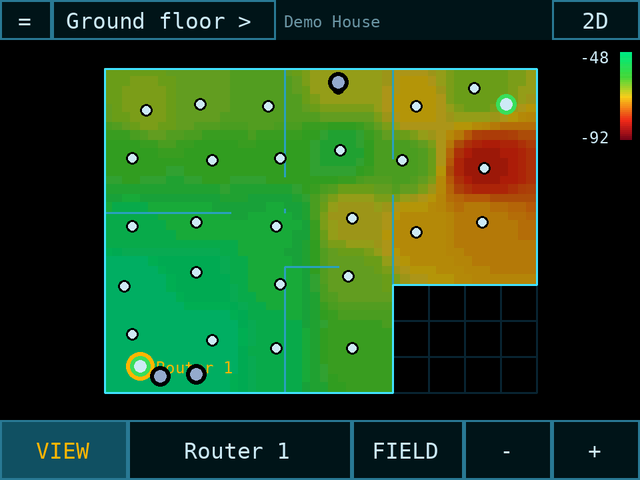</td>
<td width="50%">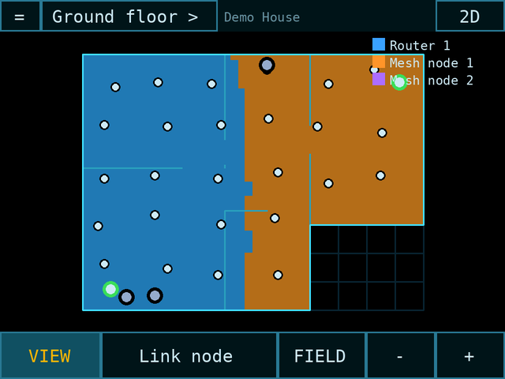</td>
</tr>
<tr>
<td><sub><b>One source at a time.</b> Cycle the source button through each bound device to see its own reach. Here, the router barely covers the far room.</sub></td>
<td><sub><b>The mesh split.</b> Which node the CYD joined at each spot. The boundary is where your devices hand over.</sub></td>
</tr>
<tr>
<td>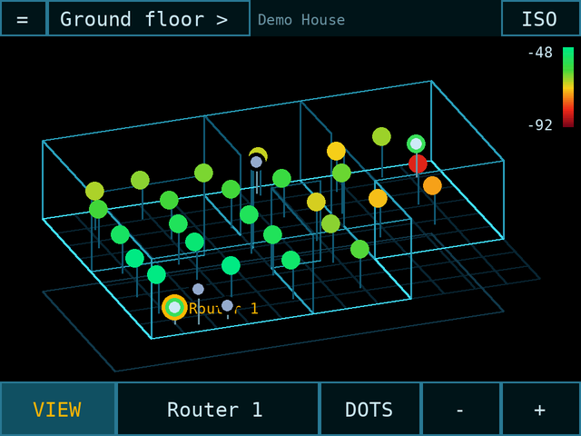</td>
<td>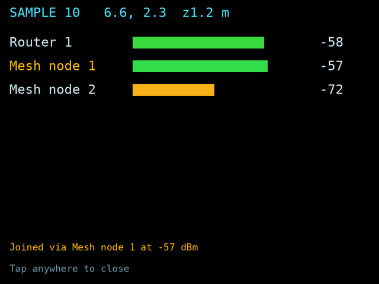</td>
</tr>
<tr>
<td><sub><b>Just the measurements.</b> <i>DOTS</i> hides the estimate and shows each reading at the height it was taken.</sub></td>
<td><sub><b>Tap any spot</b> for its breakdown: every bound device, and which one it joined.</sub></td>
</tr>
</table>

## 📐 Floor plans, traced for you

The plans that come with a house sale are black-and-white line drawings full of clutter: door swings, room names, dimensions, stairs, a compass, a scale bar. The setup page finds the walls among all that and traces them: the outside of the building as one closed shape, and the interior walls as lines. You check it, set the scale by tapping two points a known distance apart, and save.

<table>
<tr>
<td colspan="2">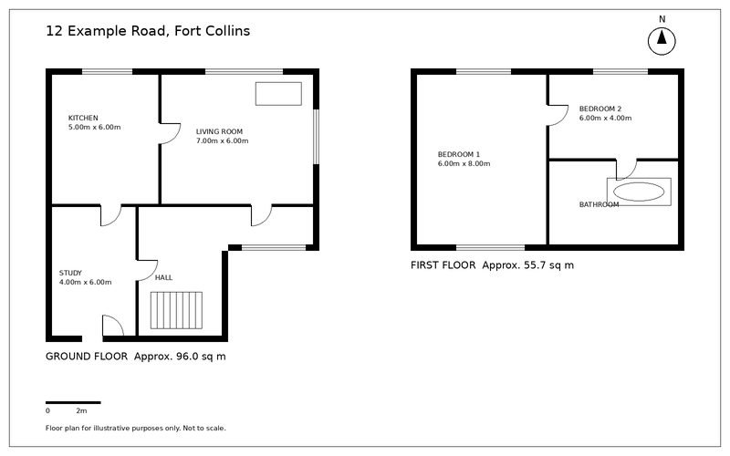</td>
</tr>
<tr>
<td colspan="2"><sub><b>In:</b> a two-floor sheet, the way agents usually supply them. Load the same image for each floor and tap the one you want; the scale carries over.</sub></td>
</tr>
<tr>
<td width="50%">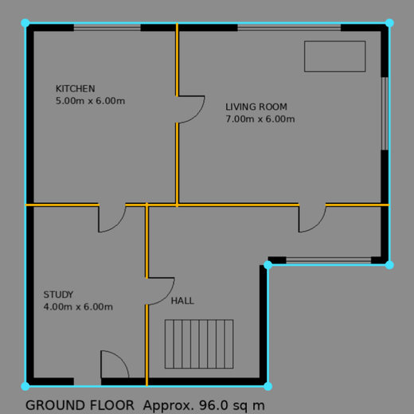</td>
<td width="50%">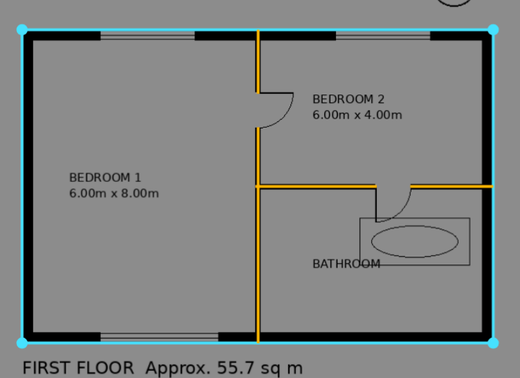</td>
</tr>
<tr>
<td><sub><b>Out:</b> ground floor, six corners and seven walls.</sub></td>
<td><sub>First floor from the same sheet.</sub></td>
</tr>
<tr>
<td>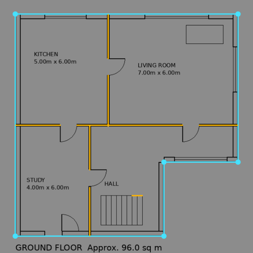</td>
<td>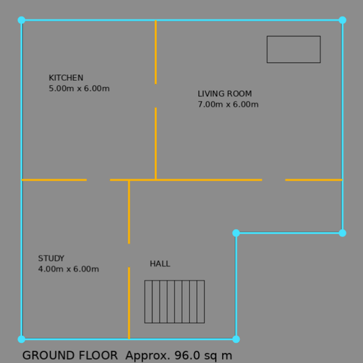</td>
</tr>
<tr>
<td><sub>Walls drawn as <b>double lines</b>.</sub></td>
<td><sub>A thin <b>single-line sketch</b>, as appraisers often draw them.</sub></td>
</tr>
</table>

Tracing finds straight horizontal and vertical walls. Angled or curved walls are added by hand with *Walls*, strays are removed with *Erase*, and a plain rectangle is one tap away for a single room. It can't read the printed dimensions, so the scale is always yours to set. So far it has been tested on generated plans ([`test/web/make_plans.py`](test/web/make_plans.py)), not yet on a collection of real survey plans.

<details>
<summary><b>The setup page</b></summary>

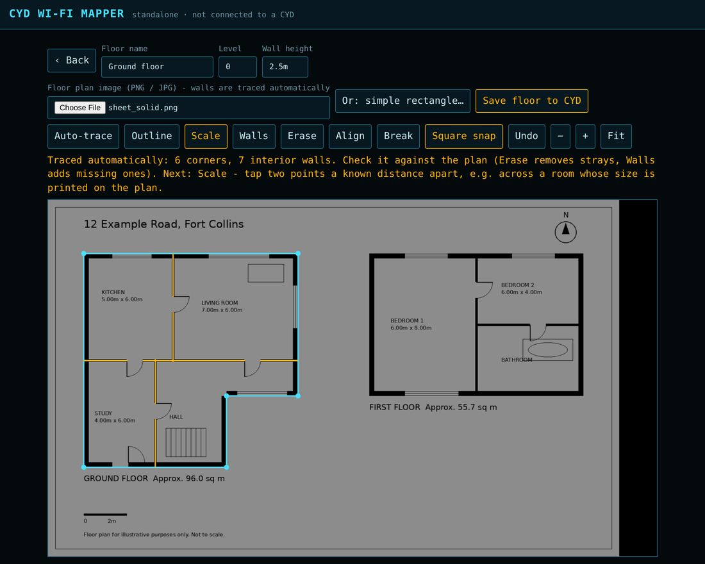

The CYD serves this page from its own hotspot, so nothing needs installing: on the CYD choose *HOTSPOT SETUP*, join the `CYD-WiFiMap` network and open `http://192.168.4.1`. The plan image never leaves your browser; only the traced lines are saved to the card. The same page also works on its own (opened from disk, or hosted anywhere) and exports each scan set as `project.json` to copy onto the card.
</details>

## 🌐 Try it in a browser

```bash
pip install ziglang playwright        # compiler for the WebAssembly build
pio test -e native                    # also fetches ArduinoJson
python tools/build_artifact.py        # -> dist/artifact.html
```

`dist/artifact.html` is the whole app in one page: the setup page, plus an emulated CYD you tap and drag with the mouse. The emulator is not a lookalike. It is [`lib/core`](lib/core), the firmware's own UI and logic, compiled to WebAssembly and drawn on a canvas, so *PLACE*, *SURVEY* and *VIEW* behave exactly as they do on the device.

The one thing a browser can't do is scan Wi-Fi, so in the browser the radio is **simulated**: every router and mesh node you place transmits, and walls and floors weaken the signal. That makes it useful for learning the workflow and for rough "what if the node went here?" planning, but its heat maps are a model, not a measurement. Readings taken on a real CYD can be imported from the card and viewed in the same page.

## 📏 What it can and can't measure

- **2.4 GHz only.** The ESP32's radio can't hear 5 GHz or 6 GHz, so faster bands aren't covered.
- **Only access points can be measured.** Routers and mesh nodes broadcast, so the CYD can hear them. Smart speakers, TVs and consoles are Wi-Fi *clients*: place them as landmarks to see what signal reaches them, but the CYD can't measure how well *they* transmit.
- **The mesh split is the CYD's view.** It joins your Wi-Fi from each spot and records the node it got. An ESP32 picks the strongest 2.4 GHz node; a phone may be steered somewhere else.
- **The field between readings is an estimate.** It is interpolated from nearby measurements and doesn't know about walls. More spots, better map.
- **Walls are a standard height per floor.** Not every room is, but it's close enough for this.

## 📦 What you need

- A **Cheap Yellow Display**, *ESP32-2432S028R* (about $15). Both the original single micro-USB board (ILI9341 panel) and the two-USB variant (ST7789) have a build.
- A **microSD card**, FAT32. Scan sets and readings live on it.
- **[PlatformIO](https://platformio.org/)**, as the CLI or the VS Code extension.
- A phone or laptop with a browser, once, to trace the floor plans.

## 🚀 Build and flash

```bash
git clone https://github.com/waywardtech/CYD-wifi-mapper.git
cd CYD-wifi-mapper
pio run -e cyd -t upload          # original single micro-USB CYD (ILI9341)
pio run -e cyd2usb -t upload      # two-USB variant (ST7789)
pio device monitor
```

On first boot the CYD asks for three calibration taps. To redo calibration later, hold a finger on the screen while powering on. If upload won't start, hold **BOOT** while it connects.

The setup hotspot uses the network name `CYD-WiFiMap` and password `mapmywifi`. Anyone who joins it can read and change the scan sets on the card, so change `AP_PASS` in [`src/main.cpp`](src/main.cpp) if that matters to you. The hotspot is only on while the *HOTSPOT SETUP* screen is open.

Giving the CYD your home Wi-Fi name and password (on the setup page) is optional. It's what lets each reading record which mesh node it joined. Without it you still get signal strength from every access point.

## 🔧 First run on hardware

Things to check, in order, the first time this meets a real CYD:

1. The splash appears with the right colours. If they're inverted or red and blue are swapped, flash the other build.
2. The calibration crosses respond, and afterwards buttons trigger where you tap.
3. The serial log shows `SD ok`, a band height of 60, and comfortable free heap.
4. *HOTSPOT SETUP* brings up the network, and the page loads. A scan set saved there appears in the CYD's list.
5. *BIND* lists nearby networks, and *SCAN HERE* takes roughly five to ten seconds and saves a reading.

Reports from a real device beat anything in the simulator. Please open an issue with what you saw.

## 🧩 How it works

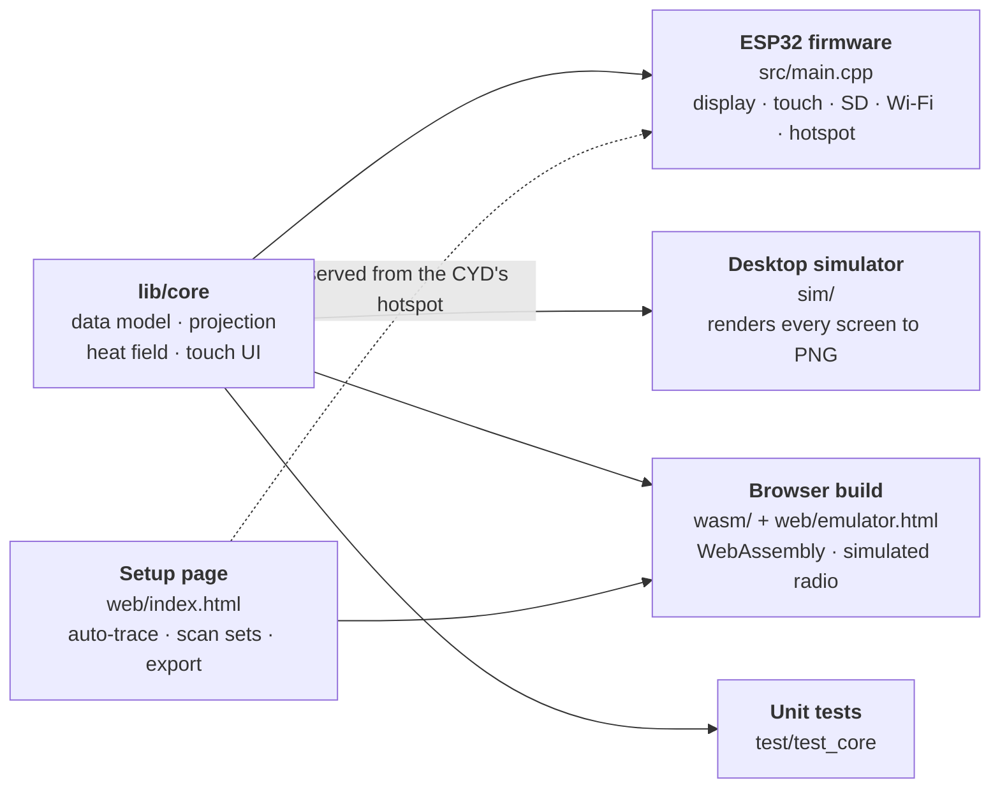

All the behaviour lives in **`lib/core`**, plain C++ with no Arduino headers. It talks to hardware through two small interfaces, a *Platform* (storage, clock, scanning) and a *Canvas* (lines, fills, text). The firmware, the simulator and the browser build each supply their own, so the same code is tested on a laptop, rendered to the screenshots above, and run on the device.

A few details that matter on a board with 520 KB of RAM and no PSRAM:

- **The screen is drawn in four 320×60 bands** through one 16-bit sprite, which keeps the frame buffer under 40 KB instead of 150 KB.
- **Readings are append-only.** Each one is a single line added to `samples.jsonl` the moment it's taken, and *UNDO* appends a marker rather than rewriting the file. A power cut can at worst lose the reading being written.
- **Scans are blocking, so the UI waits for the "Scanning…" overlay** to reach the screen before starting one.
- **Plan tracing runs in the browser**, not on the CYD: thick strokes are walls, small blobs are text, door gaps are bridged, and whatever the outside can't flood into is the building.

## 🧑‍💻 Develop

No hardware is needed for any of this:

```bash
pio test -e native                         # unit tests for lib/core
pio run -e cyd -e cyd2usb                  # firmware builds for both CYD variants
sim/run.sh                                 # render every device screen to sim/out/*.png
python tools/mock_device.py                # setup page at http://localhost:8032 with a fake SD card
python test/web/test_web.py                # setup page end to end in headless Chrome
python test/web/test_autotrace.py          # plan tracing on generated sheets
python tools/build_artifact.py && python test/web/test_emulator.py   # browser build, end to end
python tools/readme_images.py              # regenerate the pictures on this page
```

CI runs all of it on every push and uploads the firmware, the browser build and the screenshots. The browser tests need `pip install pillow playwright` and Chrome.

## 🗂️ Repository layout

```
lib/core/            portable C++: model + JSON + projection + heat field (wm_core), UI (wm_app), host fakes
src/main.cpp         CYD glue: TFT_eSPI display, bit-banged touch, SD, Wi-Fi scan, hotspot + web API
web/index.html       setup page: auto-trace, scan sets, export (gzipped into the firmware at build time)
web/emulator.html    emulated CYD screen for the browser build
wasm/                WebAssembly entry point for lib/core
sim/                 desktop simulator and screenshot renderer
test/test_core/      host unit tests
test/web/            browser tests and the generated plan sheets they trace
tools/               web embedding, browser build, mock device, README pictures
docs/DATA_FORMAT.md  what's on the SD card
docs/images/         the pictures on this page
```

## 🔭 Next

- Run it on real hardware and fix what that turns up
- Move a placed object by dragging, and rename it on the device
- Signal strength of client devices (speakers, TVs, consoles) by listening for their traffic
- Interpolation that knows about walls
- Compare two scan sets: before and after moving a node
- Angled walls in auto-trace

## 📜 License & credits

[MIT](LICENSE) © 2026 Daniel Teixeira-Gomes. All code, plans and pictures in this repository are original; the demo house and its floor plans are invented. The firmware *uses*, but does not include, [TFT_eSPI](https://github.com/Bodmer/TFT_eSPI) (FreeBSD-style), [ArduinoJson](https://arduinojson.org) (MIT) and the [ESP32 Arduino core](https://github.com/espressif/arduino-esp32) (LGPL-2.1), all compatible with distributing this project under MIT. Tests use [Unity](https://github.com/ThrowTheSwitch/Unity) (MIT) and [Playwright](https://playwright.dev) (Apache-2.0).

Thanks to Brian Lough and the [Cheap Yellow Display community](https://github.com/witnessmenow/ESP32-Cheap-Yellow-Display) for making a $15 board feel like a platform.
